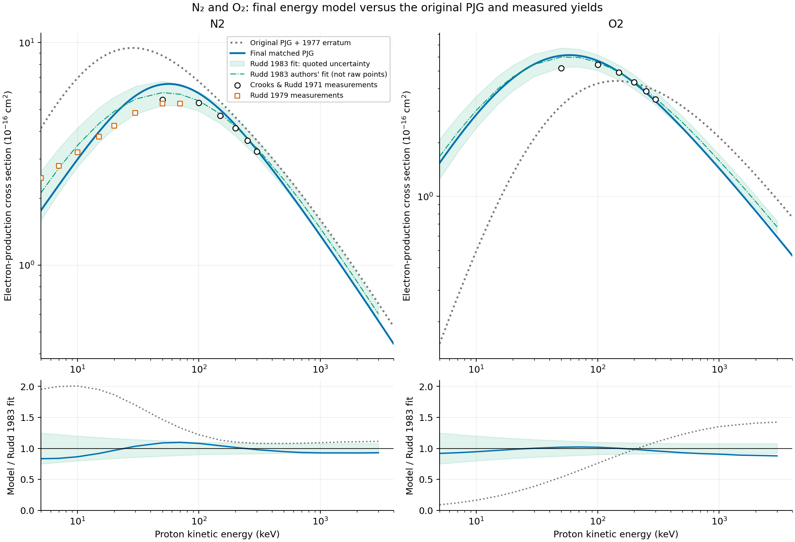
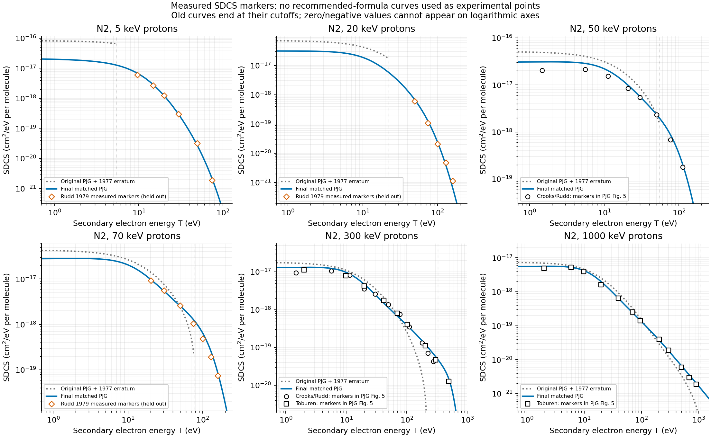
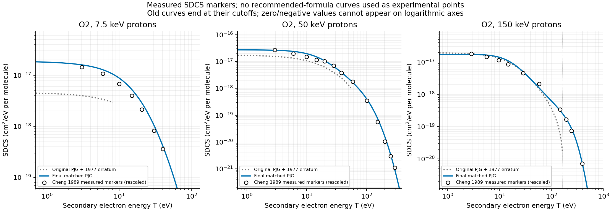

.. _proton-ionization-calibration:

PJG sources, calibration and original model
===========================================

This page preserves the original-model comparison and experimental provenance.
The current equations and conventions are defined in
:ref:`multiphysics-collisions-proton-impact-ionization`. Historical coefficients
below are comparison inputs, not a second production model.

Original PJG formula
--------------------

After applying the 1977 addition-sign correction, the original proton
Eq. (16) is

.. math::
   :label: pjg-original

   S_{\rm P}(E,T)=\frac{D_{\rm P}(E)}{E_e}\left\{
   K\Gamma(E)^2\sum_j f_j L_j(E)
   \left[\frac{1}{(T-T_0)^2+\Gamma(E)^2}
   -\frac{B(E_e)}{(T-T_1)^2+\Gamma_b^2}\right]
   +N_e C_B\sum_j f_j\left[
   \frac{1}{4(E+2M)^2}
   -\frac{1}{(T_{m,\rm P}+I_j+\delta)(T+I_j)}\right]\right\},

with

.. math::

   \begin{aligned}
   F_j(E)&=f_jD_{\rm P}(E),&
   D_{\rm P}(E)&=\frac{1}{1+(J/E_e)^p},&p&=1+\nu,\\
   L_j(E)&=\ln(4E_e\gamma^2C_j/I_j+\mathrm e)-\beta^2,&&&\\
   \Gamma(E)&=\Gamma_s+\frac{g_1}{E_e+g_2},&
   T_0(E)&=T_s-\frac{t_a}{E_e+t_b},&&\\
   B(E_e)&=B_0\{[\ln(E_e/E_0)]^2+B_1\},&&&\\
   T_{m,\rm P}&=\frac{E(E+2M)}{E+m+(M/m)(E+M)}.&&&
   \end{aligned}

The symbol :math:`\Gamma_b` here denotes PJG's fixed broad-width parameter
:math:`\Gamma_1`; :math:`g_1,g_2` denote its proton-width coefficients
:math:`\gamma_1,\gamma_2`. This avoids three different meanings of a
subscript ``1``. Dimensional consistency requires :math:`g_1,t_a` in eV2,
irrespective of the unit labels alongside the printed numerator parameters.
The proton row prints :math:`\nu=-0.193,0.314`, giving the powers above.

.. list-table:: Original proton parameters, including inherited Table III entries
   :header-rows: 1
   :widths: 44 28 28

   * - Quantity
     - N2
     - O2
   * - :math:`N_e`
     - 14
     - 16
   * - :math:`K` (cm2)
     - :math:`7.58\times10^{-16}`
     - :math:`6.55\times10^{-16}`
   * - :math:`\Gamma_s` (eV)
     - 11.1
     - 13.1
   * - :math:`g_1` (eV2), :math:`g_2` (eV)
     - 12700, 1810
     - 500000, 76000
   * - :math:`T_s` (eV), :math:`t_a` (eV2), :math:`t_b` (eV)
     - 4, 20300, 1970
     - 6.34, 2520, 128
   * - :math:`T_1,\Gamma_b` (eV)
     - 53.3, 115
     - 68.3, 189.1
   * - :math:`J` (eV), :math:`p`
     - 3.39, 0.807
     - 40.3, 1.314
   * - :math:`\delta` (eV)
     - 84
     - 132.1
   * - :math:`B_0,B_1,E_0` (last entry in eV)
     - 0.029, 1.035, 8239
     - 0.030, 1.035, 8239

.. _pjg-continuum-allocation:

.. list-table:: Fixed original continuum allocation, retained in the final model
   :header-rows: 1
   :widths: 12 34 30 24

   * - Target
     - :math:`I_j` (eV), in channel order
     - :math:`f_j`
     - Original :math:`C_j`
   * - N2
     - 15.58, 16.73, 18.75, 22, 23.6, 40
     - .456, .2, .104, .07, .07, .1
     - 2.48, 2.66, 2.99, 3.50, 3.76, 6.37
   * - O2
     - 12.1, 16.1, 16.9, 18.2, 20.3, 23, 37
     - .08, .19, .19, .17, .11, .16, .1
     - 1.93, 2.56, 2.69, 2.90, 3.23, 3.66, 5.89

Each set of :math:`f_j` sums to one. These are effective continuum weights,
not orbital electron occupancies; multiplying each by :math:`N_e` does not
make them an exclusive molecular-channel model. The constants
:math:`C_j/I_j` are almost common, differing by table rounding.

PJG used the modified Breit--Wigner/Lorentzian form of Green and Sawada to
describe low-energy electron spectra, with a high-energy continuation
motivated by their oscillator-strength calculation. Their text on p. 158
describes fitting electron-impact shapes to Opal et al. and normalization
to Rapp and Golden; those statements concern the electron branch. The
proton branch inherits :math:`K,T_s,\Gamma_s,T_1,\Gamma_b,C_j,f_j,B`
and changes the distortion, width and peak-energy functions. Its comparisons
use Crooks--Rudd and Toburen proton spectra and the total data in Figs. 5--6.
The paper does not supply a reproducible proton least-squares objective,
point weights, parameter covariance, or an independent measurement of
:math:`\delta`. Those details cannot be reconstructed uniquely from Table III.

PJG explicitly acknowledges electrons beyond its classical binary edge but
chooses :math:`T_{m,\rm P}` as a practical cutoff (p. 160). For the original
comparison we therefore use :math:`0\leq T\leq T_{m,\rm P}` and zero outside.
Writing

.. math::

   H(U;c,a)=\frac{\arctan[(U-c)/a]+\arctan(c/a)}{a},

its total is exactly

.. math::

   \sigma_{\rm P}=\frac{D_{\rm P}}{E_e}\left\{
   K\Gamma^2\sum_jf_jL_j[H(U;T_0,\Gamma)-B H(U;T_1,\Gamma_b)]
   +N_eC_B\sum_j f_j\left[
   \frac{U}{4(E+2M)^2}
   -\frac{\ln(1+U/I_j)}{T_{m,\rm P}+I_j+\delta}\right]\right\},
   \qquad U=T_{m,\rm P}.

This definition preserves signed original values. Negative values are not
clipped when integrating or comparing the original model; a logarithmic
plot simply cannot display them. The original subtraction does not guarantee
positivity or the free-electron hard normalization outside its empirical fit.

The complete 1977 correction notice
~~~~~~~~~~~~~~~~~~~~~~~~~~~~~~~~~~~

The following corrections in :cite:t:`b-Garvey1977` define what is meant by
``original PJG`` throughout this comparison:

* Eq. (14): :math:`\arctan\alpha_2\to\arctan(\alpha_2/2)` and the denominator
  :math:`\beta_1\to\beta_2`.
* Fig. 1(a): :math:`w=52.2\to58.2`.
* Table II: add :math:`b_5` to :math:`\beta_2` and :math:`g_5` to :math:`\gamma`;
  :math:`b_5=0.654` for N2 and 0.619 for O2, and :math:`g_5=1` for both.
* Table II: the O2 :math:`a_2` is :math:`4.107\times10^{-1}`.
* Eq. (16): the raised plus sign means ordinary addition of the next term,
  **not** a positive-part operation or a superscript.
* Table III: the electron-branch O2 :math:`E_\Gamma` is :math:`-129.1` eV.

Eq. (14) and Table II concern the generalized-oscillator-strength (GOS)
construction; they are not used directly by the proton Eq. (16).
The electron-branch :math:`E_\Gamma` likewise does not enter its proton
width. Only the addition-sign correction changes the parsing of Eq. (16).
The notice does not correct its printed :math:`T_m` or Bhabha factors.

Direct evaluation of the original equation and Table III still does not
reproduce the low-energy N2 curve in Fig. 6. Restoring the printed cutoff
and hard remainder therefore does not resolve that inconsistency. An
undocumented difference between the figure calculation and the printed
equation/table is a plausible explanation, not an established historical
fact. The comparison below uses the explicitly defined equation, not a
substitution of the plotted line or invented missing coefficients.

Data, provenance and fitting procedure
--------------------------------------

.. list-table:: Numerical constraints and held-out comparisons
   :header-rows: 1
   :widths: 35 30 35

   * - Source
     - Numerical information
     - Treatment
   * - :cite:t:`b-Crooks1971`, Table I
     - Six N2/O2 totals, 50--300 keV
     - Measured inclusive electron yields; approximately 17% shared normalization uncertainty
   * - :cite:t:`b-Rudd1979`, Table I
     - Eight N2 totals and mean secondary energies, 5--70 keV
     - Measured constraints, with lower weight at the least reliable low incident energies
   * - :cite:t:`b-Rudd1983`, Table V
     - 18 rows, 5--3000 keV
     - Authors' fit to measurements, **not raw measured points**; omit the extrapolated 5000 keV row
   * - :cite:t:`b-Porter1976`, Fig. 5; :cite:t:`b-Crooks1971,b-Toburen1971`
     - 49 digitized N2 spectral markers at 50, 100, 300 and 1000 keV
     - Measured shapes; separate incident energy and experimental source normalizations
   * - :cite:t:`b-Cheng1989`, Fig. 1
     - 30 digitized O2 markers at 7.5, 50 and 150 keV
     - Shapes; published spectra already adjusted to recommended totals
   * - :cite:t:`b-Rudd1992`
     - Analytic recommended SDCS on a coarse logarithmic grid
     - Weak interpolation prior, not additional experimental points
   * - :cite:t:`b-Sakamoto2010`
     - N2 evaluated absorption, loss 25--100 eV
     - Approximate smooth ionization/dipole constraint
   * - :cite:t:`b-Heays2017,b-Hrodmarsson2023`
     - Leiden O2 evaluated photoionization, loss 25--100 eV
     - Ionization column, not total absorption
   * - :cite:t:`b-Rudd1979`, Fig. 7
     - 18 N2 markers at 5, 20, 70 keV
     - Held out of the spectral fit; same paper's totals/means are fitted
   * - NIST PSTAR
     - Electronic mass stopping for nitrogen/oxygen gases
     - Independent energy-budget comparison, no fit penalty

Digitization coordinates, axis calibration, source-PDF SHA-256 digests and
unit conversions are retained in ``source_datasets.py``. Cheng's plotted
ordinate is :math:`K_{\rm nr}(T+13.1\,{\rm eV})^2S/C_B`, not the SDCS
itself; 13.1 eV is the reference binding used in that paper's Table I.
Marker-reading sensitivity is additional to experimental uncertainty.
The N2 1979 absolute scale was tied to the 1971 measurements; these are not
independent normalizations. Toburen quotes about 25% absolute uncertainty
over most of the secondary-energy interval. Table V of Rudd 1983 is
calculated from that paper's Eq. (17); its negative-charge electron yield
is distinct from the positive-ion yield that also includes capture.

Minimize the sum of squared **logarithmic residuals**, in logarithmic fit
parameters, with the following residual-block weights:

* Rudd-1983 totals: :math:`0.15/u(E)`, divided by the square root of 18.
  The published estimated fractional uncertainties are 0.25, 0.20, 0.15,
  0.10 and 0.08 at 5, 10, 25, 100 and 500 keV, interpolated in log energy
  and held at 0.08 above 500 keV.
* Crooks totals: 0.5 divided by the square root of six.
* N2 1979 totals and means: respectively 0.4 and 1, divided by the square
  root of eight, with confidence multipliers 0.5 at 5 keV, 2/3 at 10 keV,
  and 1 at/above 30 keV, interpolated in log energy.
* Recommended Rudd-1992 SDCS: 0.25 divided by the square root of the number
  of retained samples. Use 48 logarithmic secondary points from 2 eV to
  :math:`\min(8K_{\rm nr},3000\,{\rm eV})`; retain reference values above
  :math:`10^{-4}` of the first value. Incident grids in keV are
  (5, 10, 30, 50, 100, 300, 1000) for N2 and
  (7.5, 10, 30, 50, 100, 300) for O2.
* Optical: 60 logarithmic points at loss 25--100 eV, with weight 1 for N2
  and 2 for O2, divided by the square root of 60. O2 has an ionization
  column; N2 uses the more approximate absorption proxy.

For measured SDCS group :math:`g` with :math:`n_g` points, define
:math:`r_i=\ln[S(E_i,T_i)/S_i^{\rm data}]` and :math:`h_i=0.5` below
10 eV, otherwise 1. Its residuals are

.. math::

   R_{g,i}=\frac{h_i(r_i-\bar r_g)}{\sqrt{N_gn_g}},\qquad
   \bar r_g=\frac{\sum_i h_i^2r_i}{\sum_i h_i^2}.

There are five N2 groups, separated by energy and measured source, and
three O2 groups. Profiling the shared log normalization prevents counting
it once per marker. This does **not** rescale the final absolute SDCS or
any plotted curve after fitting. The total and shape remain coupled by
Eq. :eq:`pjg-final`.

These are explicit judgment weights for heterogeneous, correlated evidence,
not fabricated pointwise standard errors, confidence bands or a chi-squared
statistic. The positive bounds used by the optimizer for
:math:`(J,K/K_{\rm printed},\Gamma,\Lambda,q_t,q_g)` are
(0.01, 0.01, 0.1, 1, 0.0001, 0.25) to (100000, 10, 100, 1000, 5, 4).
The zero-peak reduction sets :math:`q_t=0` outside this positive
parameterization and does not optimize it. Least-squares termination uses
``ftol=xtol=1e-10``, ``gtol=1e-9`` and at most 600 function evaluations.
Alternate starts reproduce the selected spectra within about
:math:`1.2\times10^{-6}` (N2) and :math:`7.4\times10^{-8}` (O2), a numerical
stability check, not a global identifiability or parameter-uncertainty result.

Optical and GOS source qualifications
~~~~~~~~~~~~~~~~~~~~~~~~~~~~~~~~~~~~~

The NIFS-DATA-109 report is a 2010 evaluation based principally on
Berkowitz's compilation, not a new measurement at its later repository
deposit date. Its selection used sum rules and polarizability; agreement
with those quantities is consequently not independent validation.
The retained extraction includes 239 N2 and 729 O2 continuum rows, discrete
strengths and integrated O2 bands. On the full evaluated response through
100 keV, linear interpolation gives integrated strengths 14.0307/15.9725,
logarithmic mean excitation energies 83.8438/97.5802 eV and polarizabilities
11.9571/10.6479 :math:`a_0^3`. Log--log interpolation changes the strengths
to 13.8994/15.8098 and mean excitation energies to 83.1648/96.9754 eV.
These are interpolation sensitivities. They are not properties of the
fitted PJG soft term alone.

The `Leiden O2 numerical file
<https://home.strw.leidenuniv.nl/~ewine/photo/data/photo_data/cross_sections/O2/O2.txt>`_
was compiled in March 2020 and uses Brion et al. (1979),
`DOI 10.1016/0368-2048(79)85032-X <https://doi.org/10.1016/0368-2048(79)85032-X>`_,
and Holland et al. (1993),
`DOI 10.1016/0301-0104(93)80148-3 <https://doi.org/10.1016/0301-0104(93)80148-3>`_,
including the latter's ionization efficiency. Current website maintenance
does not turn those into 2026 measurements. On the fitted optical interval,
the alternative Leiden/NIFS N2 ratio is 0.898--1.117 and the NIFS-absorption/
Leiden-ionization O2 ratio is 0.927--1.028. Shared sources prevent treating
these evaluations as independent replicates. Interpolation does not
extrapolate past tabulated support or bridge the separate O2 band interval.

The full texts of :cite:t:`b-Gallagher1988` and :cite:t:`b-Mahla2025` and
the latter's `numerical supplement
<https://doi.org/10.60893/figshare.jcp.30757583.v1>`_ were examined. The
2025 O2 calculation has a raw ground-channel onset of 10.993 eV, rather
than the experimental adiabatic threshold near 12.07 eV, and does not apply
a term-energy correction. Its three grouped partial tables sum to 81.593 Mb
at 23.313 eV versus a total of 92.81 Mb. The cause of the nonclosure is
unresolved; the partials are not silently renormalized. This newer calculation
is therefore a comparison, not the absolute optical anchor. The JILA
Data Center Report No. 32 numerical tabulation cited by Gallagher was not
available, so no additional numerical partial-channel block was fabricated.

:cite:t:`b-Sun2005,b-Lin2013` provide N2/O2 finite-momentum-transfer
electron-energy-loss information. The N2 normalization uses optical data
and a valence sum rule; the O2 work quotes roughly 20--40% uncertainties
and normalizes to an earlier spectrum. Its reported 0.23 and 0.91 atomic-unit
quantities are :math:`q^2`, not :math:`q`. Dipole-forbidden structure has
different momentum dependence from the optical continuum. These papers
constrain interpretation, but an already momentum-integrated SDCS does
not define a unique :math:`F(q,W)`; no numerical full-GOS fit is claimed.
The 2016 low-energy ion/fragment study,
`DOI 10.1016/j.ijms.2016.05.014 <https://doi.org/10.1016/j.ijms.2016.05.014>`_,
is excluded because the available abstract does not establish the required
capture and multiplicity conversion to inclusive electron yield.

Comparison with totals and differential data
--------------------------------------------

All ratio ranges below refer to the stated comparison grid, not a guaranteed
uniform accuracy bound. Against the Rudd-1983 authors' total fit the final
N2/O2 ratios span 0.834--1.096 / 0.879--1.023, with log-RMS residuals
0.0908 / 0.0695. The original PJG+erratum ranges are
1.079--2.007 / 0.090--1.424. Final ratios to Crooks' measured totals are
1.016--1.174 / 0.976--1.177. Some discrepancies exceed individual nominal
bands; this is a joint spectral/optical/total compromise, not the best
possible total-only interpolation.

   Totals and residual ratios. Gray: original Eq. (16) plus erratum;
   blue: final model. Symbols denote measurements. The green curve and
   envelope are Rudd's measurement-derived fit and estimated uncertainty,
   not recovered raw experimental points.

   N2 SDCS comparisons. The 5, 20 and 70 keV spectral markers are held out
   of the shape fit, though their paper's totals and means enter it.
   The original curve terminates at its printed binary cutoff.

   O2 SDCS with Cheng's published, recommendation-normalized markers.
   Markers are not rescaled to the final model.

.. list-table:: Final SDCS / digitized data and normalization-profiled shape log-RMS
   :header-rows: 1

   * - Target and incident energy
     - Ratio range
     - Shape log-RMS
   * - N2, 50 keV, PJG markers
     - 1.009--1.519
     - .128
   * - N2, 100 keV, PJG markers
     - .919--1.509
     - .151
   * - N2, 300 keV, PJG markers
     - .784--1.569
     - .184
   * - N2, 1 MeV, PJG markers
     - .939--1.244
     - .087
   * - N2, 5 keV, held-out markers
     - .857--1.131
     - .098
   * - N2, 20 keV, held-out markers
     - .571--1.191
     - .285
   * - N2, 70 keV, held-out markers
     - .962--1.336
     - .124
   * - O2, 7.5 keV
     - 1.101--1.345
     - .073
   * - O2, 50 keV
     - .873--1.481
     - .158
   * - O2, 150 keV
     - .750--1.278
     - .151

The displayed 300 keV N2 summary pools two experimental sources; the fit
profiles them separately. Important residuals remain: the last held-out
20 keV N2 point near 160 eV is underpredicted by about 43%, and O2 has an
approximately 48% excess near 202 eV at 50 keV. Optical forward-map ratios
over 25--100 eV are .842--1.320 (N2) and .781--1.185 (O2), with log-RMS
.140 and .097. Agreement with Rudd's analytic SDCS is reported separately
by the reproduction tools and must not be relabeled experimental agreement.
